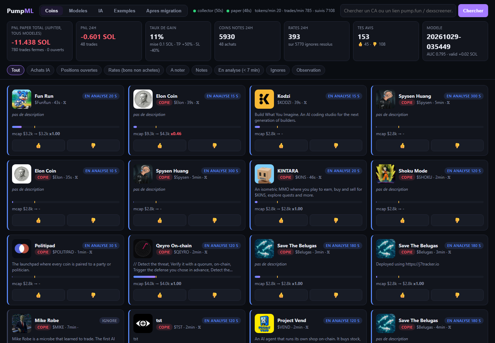
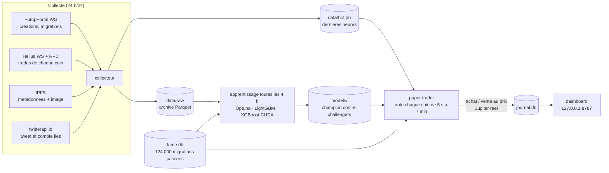
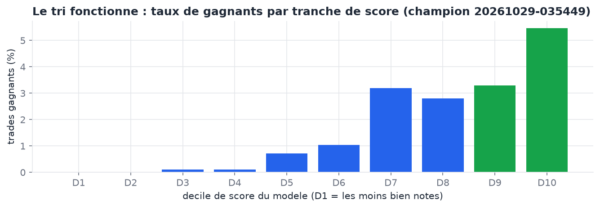
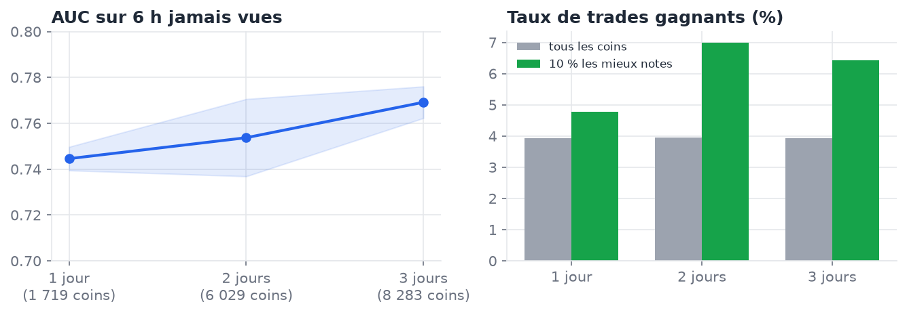
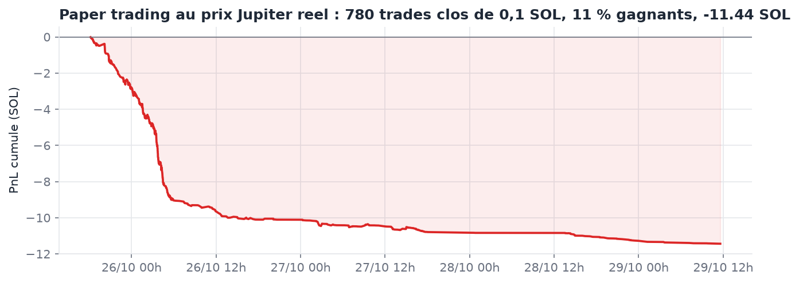
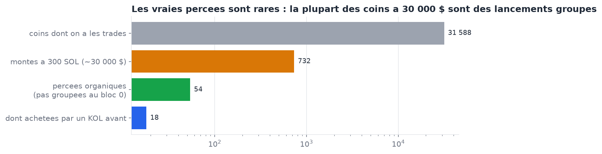
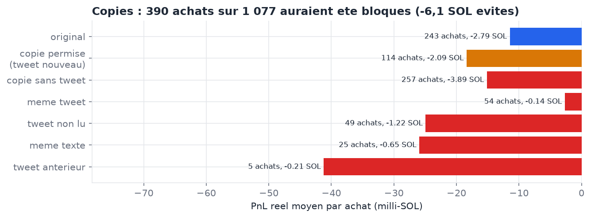

<div align="center">

# PumpML

**Une IA qui apprend seule à lire la *narrative* de chaque nouveau memecoin pump.fun et qui trade en papier ceux auxquels elle croit, 24 h/24, au vrai prix Jupiter.**

[](LICENSE)


[🇬🇧 English version](README.md) · [Résultats](#résultats-à-ce-jour-chiffres-honnêtes) · [Comment il décide](#comment-le-modèle-décide) · [Démarrage](#démarrage) · [Arborescence](#arborescence) · [Contribuer](#comment-aider)



</div>

> [!WARNING]
> **C'est un projet de recherche, pas une machine à billets.** PumpML n'a **jamais** envoyé une vraie transaction : chaque trade est simulé avec de vraies cotations Jupiter. Après 5 jours de données, le modèle classe les coins bien mieux que le hasard, mais il **n'est pas encore rentable**. Rien ici n'est un conseil financier. L'immense majorité des coins pump.fun finit à zéro.

---

## Pourquoi ce projet

Environ 25 000 memecoins sortent chaque jour sur [pump.fun](https://pump.fun) (Solana). Presque tous meurent en quelques minutes. Les rares qui décollent ont souvent un point commun : une **histoire** que les gens ont envie de partager. Ce peut être un tweet viral d'il y a une minute, une actu, un animal, ou une blague que tout le crypto-Twitter comprend.

Les bots de trading regardent d'habitude le prix, le volume et les holders. PumpML fait exprès l'inverse : **il décide sur la narrative seulement**. Il regarde le tweet, l'image, le nom, la description, le site, le créateur, la ressemblance aux anciens gagnants et aux flops, et les copies. Le prix et le flux de trades restent *hors* de ses poids. La question posée :

> *Une machine peut-elle apprendre, sur des dizaines de milliers d'exemples, quelles histoires de memecoins prennent, avant que le marché ne le voie ?*

Il tourne sur un seul PC de jeu (RTX 3070, 32 Go de RAM). Il collecte tout lui-même, se réentraîne seul et montre ce qu'il pense dans un dashboard local.

## Ce qu'il fait



1. **Collecter** chaque coin créé sur pump.fun et ses métadonnées, son image et son tweet lié.
   - Les créations sont vues à 100 %, grâce à l'abonnement au compte d'autorité de mint.
   - L'historique complet des trades est suivi pour la moitié des coins (Helius, coin par coin).
2. **Noter** chaque coin à 12 points d'analyse (5 s, 10 s… 7 min après le lancement), avec seulement ce qui était connu à cet instant.
3. **Acheter en papier** au premier point où le score dépasse le seuil, au prix d'une **vraie cotation Jupiter**.
   - Sortie à +50 % ou à −40 %.
   - Sortie après 2 min si rien ne se passe, et au plus tard après 30 min.
4. **Apprendre** toutes les 4 h : les features sont recalculées et le modèle réentraîné sur tout ce dont le résultat est connu. Un nouveau modèle remplace le champion **seulement** s'il gagne plus de SOL sur des heures jamais vues.
5. **Réfléchir** toutes les 4 h : une tâche d'analyse lit les plus gros vrais gagnants, les pires achats du modèle et les percées ratées. Elle en tire des leçons, réinjectées comme exemples annotés.

## Résultats à ce jour (chiffres honnêtes)

Données collectées du 25/10 au 29/10 (5 jours, une nuit perdue PC éteint) :

| | |
|---|---|
| Coins vus | **150 805** (2,48 M trades, 151 000 métadonnées, 87 000 tweets lus) |
| Coins notés en direct par le modèle | **22 753** |
| Achats en papier (0,1 SOL, prix Jupiter) | **1 110**, dont 780 clos |
| Mémoire longue | **124 441** migrations passées (90 jours on-chain + le jeu de données académique [MemeTrans / MELT](https://github.com/git-disl/MELT), CC BY-NC 4.0, non redistribué ici) |
| Modèles entraînés | **64**, dont 5 recherches profondes de 344 à 400 essais (CPU + GPU) |

### Le tri marche…

Sur des heures jamais vues, les coins notés dans les 10 % du haut gagnent **5,5 %** du temps, contre **moins de 0,1 %** pour les 40 % du bas. L'AUC tourne autour de 0,77 à 0,80.



Plus de données aide. Sur le même test jamais vu, entraîner sur 1, 2 puis 3 jours fait passer l'AUC de 0,745 à 0,769. Le taux de gagnants des 10 % du haut passe de 4,8 % à 6,4 %.



### …mais il ne gagne pas encore d'argent

Sur les mêmes 6 heures jamais vues, *tout acheter* perd environ **−14 SOL**. Le modèle n'achète qu'une poignée de coins et perd **−0,01 à −0,2 SOL**. C'est énormément mieux que d'acheter à l'aveugle, mais ça reste une perte.

En direct, le compte papier est à **−11,4 SOL après 780 trades** (11 % de gagnants). L'essentiel a été perdu le premier jour, avant les règles d'exclusion et le passage à la narrative seule. Depuis, la courbe est presque plate.



Verdict honnête : **pas encore d'avantage prouvé.** Il faut environ deux semaines de données pour conclure ; le prochain point est prévu vers le 08/11.

### Ce qu'on a appris en route

**La plupart des « pumps » sont faux.** Sur 732 coins montés à ~30 000 $ de market cap, seuls 54 l'ont fait naturellement. Les autres ont été achetés dès le premier bloc par les propres wallets du créateur (lancements groupés). S'entraîner dessus apprend au modèle les narratives de rug.



**Les copies perdent plus que les originaux.** 708 des 1 077 premiers achats papier étaient des copies d'un coin plus ancien : même image, même lien X, ou même nom et ticker. La règle « jamais de copie, sauf si son tweet apporte une info nouvelle », rejouée sur ces achats, en aurait évité 390, soit **6,1 SOL** de pertes. Elle est active (`block_copies`).



<details>
<summary><b>Journal complet des expériences</b> (chaque changement est testé en A/B sur des heures jamais vues et consigné dans <code>rapports/experiences/JOURNAL.md</code>)</summary>

| Date | Question | Résultat (validation = heures récentes jamais vues) | Décision |
|---|---|---|---|
| 26/10 | Sortie à +100 % ou +50 %, vente à 2 min si rien ? | −9 % de pertes, positions de 3 à 5 min au lieu de 20 à 26 | Adopté |
| 26/10 | Objectif : binaire / pondéré par le PnL / régression | Aucun ne bat « tout acheter » par achat | Pondéré gardé |
| 26/10 | Exclure les lancements groupés (> 25 % de la courbe au bloc 0) | 42 % des achats IA en étaient, deux fois plus perdants en direct | Adopté |
| 26/10 | Recherche profonde, 400 essais sur 1 période | +0,55 SOL en arrêt précoce → −0,13 en validation | Sur-ajustement → 3 périodes |
| 26/10 | Narrative seule contre tous les signaux (prix, flux, heure) | narrative −0,13 SOL / 11 achats ; tout −0,36 / 23 (tout acheter −11,5 / 1 321) | **Narrative seule** |
| 27/10 | « Gagnant » = plus haut ≥ 100 k$ **et** encore ≥ 30 % une heure après | 101 vrais gagnants sur 494 « gagnants » au plus haut du jour | Règle de tenue gardée |
| 27/10 | Signaux KOL (wallets d'influenceurs) | Même résultat : un KOL avait acheté avant la décision sur 1,1 % des lignes seulement | Gardé, peu d'effet |
| 27/10 | 10 stratégies de sortie sur les coins KOL | Toutes négatives | Inchangé |
| 27/10 | Prédire les achats des gros KOL | Borne haute : acheter juste avant un gros nom = 70 % de gagnants ; prédicteur narratif AUC 0,55 à 0,65 | Trop peu de positifs |
| 27/10 | Courbe d'apprentissage 1 / 2 / 3 jours | AUC 0,745 → 0,754 → 0,769 | Continuer la collecte |
| 28/10 | Bloquer les copies sauf tweet nouveau | 390 achats sur 1 077 bloqués, −6,1 SOL évités | Adopté |
| 28/10 | Mémoire des coins percés (~30 000 $) | −0,049 / 4 achats contre −0,063 / 7, AUC 0,779 contre 0,784 | Pas de conclusion, à retester |

</details>

## Comment le modèle décide

**Signaux, seuls autorisés dans les poids** (`training.feature_groups` dans [`config.toml`](config.toml)) :

| Groupe | Ce qu'il regarde | Code |
|---|---|---|
| `narrative` | Plongements CLIP (texte + image) sur GPU, accord image ↔ nom, thèmes (actu, politique, animaux, IA…) et « gravité » du texte et du tweet, ressemblance aux coins des dernières heures et à leur résultat | [`narrative.py`](pumpml/narrative.py) |
| `tweet` | Tweet lié : âge (lu gratuitement dans l'identifiant), abonnés de l'auteur, certification, âge du compte, engagement, réponse ou citation d'un tweet viral, le tweet nomme-t-il le coin | [`social.py`](pumpml/social.py), [`features.py`](pumpml/features.py) |
| `meta` | Nom, ticker, description, site (vrai site ? l'adresse reprend-elle le nom ?) | [`features.py`](pumpml/features.py) |
| `gagnants` | Mémoire longue de 124 000 migrations : vrai gagnant et flop les plus proches, copie ou *clin d'œil* à un coin célèbre, créateur ayant déjà fait un gagnant | [`fame.py`](pumpml/fame.py) |
| `copies` | Même ticker / nom / image (empreinte visuelle) / lien X qu'un coin plus ancien, et ce qu'a donné l'original | [`vamp.py`](pumpml/vamp.py) |
| `createur` | Historique du wallet créateur : coins précédents, migrations, lancements dans l'heure | [`dataset.py`](pumpml/dataset.py) |
| *(testés)* `kol`, `kolnarr`, `percees` | Wallets d'influenceurs acheteurs, ressemblance aux achats des meilleurs traders Kolscan, ressemblance aux coins qui ont percé | [`kol.py`](pumpml/kol.py), [`kolnarr.py`](pumpml/kolnarr.py), [`percees.py`](pumpml/percees.py) |

**Règles dures (jamais dans les poids, toujours appliquées)** :
- pas de lancement groupé ;
- pas de tweet de plus de 2 min au lancement ;
- pas de réponse « parasite » (un petit compte qui s'accroche au tweet viral d'un autre) ;
- pas de coin sans Twitter ni site ;
- pas de coin noyé sous les robots de volume ;
- pas de copie d'un coin plus ancien, sauf si son tweet est nouveau et différent.

**Aucune fuite du futur.** Chaque feature n'utilise que ce qui était connu à `instant de décision + 3 s de latence` :
- le résultat des autres coins, seulement une fois résolu ;
- les mémoires, seulement une fois le succès connu ;
- les annotations, à partir de l'heure où elles ont été écrites.

Chaque feature historique a son test dans [`tests/test_core.py`](tests/test_core.py).

**Entraînement.** [`search.py`](pumpml/search.py) lance une recherche Optuna sur :
- la famille de modèle (LightGBM sur CPU, XGBoost sur CUDA) ;
- les réglages et l'objectif ;
- le poids des données récentes et le **poids de chaque groupe de signaux**.

Le modèle final est un ensemble des 5 meilleurs essais. Le découpage est temporel et par coin : entraînement, puis arrêt précoce (3 périodes), puis validation sur les 6 dernières heures, jamais utilisées pour choisir quoi que ce soit. Le seuil d'achat est choisi sur l'entraînement. Pour être **promu**, un modèle doit avoir au moins 10 achats en validation, un PnL positif, et battre le champion sur les mêmes heures.

**Simulation.** Chaque ligne d'entraînement répond à « et si j'avais acheté 0,1 SOL à ce point d'analyse ? ». Elle compte :
- l'entrée après 3 s de latence ;
- les frais pump.fun (1,25 % par sens) et 0,0005 SOL par transaction ;
- les vraies règles de sortie.

Les trades papier en direct utilisent de vraies cotations Jupiter, jamais un calcul de courbe.

## Arborescence

```
pumpml/                  tout le systeme (paquet Python : python -m pumpml <commande>)
├── collector.py         ingestion : PumpPortal + Helius, metadonnees, X, migrations → data/raw + data/hot.db
├── tokstream.py         abonnements Helius coin par coin, rattrapage des trous par RPC
├── amm.py               apres migration : suivi des pools PumpSwap (observation seulement)
├── metadata.py          metadonnees IPFS et telechargement des images (plusieurs passerelles)
├── social.py            fournisseurs X / Twitter (twitterapi.io, API officielle), date lue dans l'ID du tweet
├── pump.py              maths de la courbe pump.fun et decodage des transactions
├── storage.py           schemas Parquet, base SQLite chaude, retention
├── features.py          features par point d'analyse, regles d'exclusion, veto des copies
├── dataset.py           table d'entrainement (une ligne par coin × point d'analyse, resultat simule)
├── narrative.py         plongements CLIP (texte + image), themes, tendance des narratives
├── vamp.py              detection des copies (ticker, nom, empreinte d'image, lien X)
├── fame.py              memoire longue des gagnants et des flops (data/fame.db)
├── protos.py            tes exemples annotes → ressemblances et categories
├── kol.py / kolnarr.py  wallets d'influenceurs : qui a achete, et ce qu'aiment les meilleurs traders
├── percees.py           memoire des coins qui ont perce pendant notre collecte
├── model.py             entrainement, registre champion / challengers, explications (SHAP)
├── search.py            recherche Optuna des reglages et du poids des signaux, ensembles
├── paper.py             decisions en direct et positions papier au prix Jupiter
├── jupiter.py           client de cotations Jupiter avec budget de debit
├── perf.py              performance de chaque modele sur 1 h / 4 h / 24 h / 48 h
├── dashboard.py         dashboard web local (aiohttp) + API
├── supervisor.py        lance et relance chaque service, planifie l'apprentissage
└── check.py, config.py, logutil.py, feedback.py, backfill.py
web/                     interface du dashboard (JS sans framework, graphiques TradingView lightweight-charts)
scripts/                 taches ponctuelles et planifiees
├── import_fame.py       90 jours de migrations on-chain + bougies de 15 min (GeckoTerminal)
├── import_melt.py       jeu de donnees academique MemeTrans → memoire longue
├── winners_report.py    toutes les 4 h : vrais gagnants de la periode, a rechercher et annoter
├── errors_report.py     toutes les 4 h : pires achats du modele et percees ratees
├── annotate_winner.py   reinjecte une lecon annotee dans la bibliotheque d'exemples
├── kol_activity.py, kol_backfill.py   tri des wallets KOL et import de leur historique on-chain
├── make_charts.py       regenere les graphiques de ce README a partir de tes donnees
└── pause.ps1, resume.ps1, install_autostart.ps1   outils de service Windows
tests/                   tests sans fuite du futur pour chaque feature historique + test de bout en bout
rapports/                rapports d'analyse et journal des experiences (rapports/experiences/JOURNAL.md)
.claude/skills/          les methodes que suit l'assistant IA (experiences, sante, analyse des gagnants)
config.toml              tous les reglages, commentes (strategie, budgets, signaux, memoires)
data/, models/, logs/    crees a l'execution — PAS dans le depot (tu construis les tiens)
```

## Démarrage

**Prérequis :**
- Windows ou Linux, Python 3.11 ou plus ;
- environ 1 Go de disque par jour de données ;
- une carte graphique NVIDIA conseillée (plongements CLIP, XGBoost). Sans elle, ça marche sur CPU, plus lentement.

```bash
git clone https://github.com/macsborb/pumpml.git
cd pumpml
python -m venv .venv
.venv/Scripts/pip install -r requirements.txt          # Linux : .venv/bin/pip
.venv/Scripts/pip install torch --index-url https://download.pytorch.org/whl/cu130   # selon ta version de CUDA
.venv/Scripts/pip install sentence-transformers
cp .env.example .env                                   # puis remplis tes propres cles
.venv/Scripts/python -m pumpml check                   # verifie les cles et les flux
.venv/Scripts/python -m pumpml supervise               # lance tout
```

Ouvre **http://127.0.0.1:8787**. Le premier modèle s'entraîne dès que assez de coins ont un résultat connu (quelques heures). Il lui faut des jours pour devenir parlant.

**Clés d'API** (dans `.env`, jamais commitées) :

| Service | Sert à | Coût |
|---|---|---|
| [Helius](https://helius.dev) | trades on-chain de chaque coin | plan Developer (49 $/mois, 10 M crédits) pour 50 % des coins ; le plan gratuit suit ~15 % (`sample_fraction`) |
| [twitterapi.io](https://twitterapi.io) | contenu du tweet et du compte liés | ≈ 0,15 $ les 1 000 tweets (facultatif : sans, les features du tweet restent vides) |
| [Jupiter](https://portal.jup.ag) | cotations du paper trading | gratuit (60 cotations/min avec une clé gratuite, 30 sans) |
| PumpPortal | créations et migrations | gratuit |

**Commandes utiles :**
- `python -m pumpml status` : état des données et du modèle ;
- `python -m pumpml learn` : entraîner maintenant ;
- `python -m pumpml deepsearch` : recherche longue des réglages ;
- `python -m pumpml features --force` : recalculer toutes les features ;
- `pytest -q tests` : lancer les tests.

Sous Windows, `scripts/install_autostart.ps1` l'installe en tâche planifiée avec relance automatique. `PumpML-Pause.bat` et `PumpML-Reprendre.bat` le mettent en pause et le relancent (pour jouer, par exemple).

Tes données restent sur ta machine : les modèles **ne sont pas** livrés avec le dépôt, tu entraînes les tiens à partir de ta propre collecte.

## Comment aider

PumpML est ouvert pour que d'autres essaient de faire mieux. Quelques questions ouvertes, tirées du journal des expériences :

- **Signaux inversés.** La ressemblance aux *mauvais* exemples et aux anciens flops *augmente* aujourd'hui le score : les mauvais exemples étaient souvent des pompes artificielles dont le prix a bien monté. Faut-il les retirer des poids, ou en faire des règles d'exclusion ?
- **Les faux « projets crypto »** (nom répété en description, mots à la mode, compte X qui n'existe pas) font la majorité des achats perdants. Un test simple « le compte X lié existe-t-il ? » suffirait-il ?
- **Copies en homoglyphes** : `Мerge` avec un М cyrillique passe à travers la détection des copies. Il faudrait d'abord normaliser les caractères qui se ressemblent.
- **Cible** : prédire un gros décollage (×2 avant le stop-loss) plutôt que le PnL d'une sortie fixe ?
- **Devancer les KOL** : acheter juste avant un gros trader gagne 70 % du temps. La narrative seule peut-elle prédire ce qu'ils vont acheter ?
- **Plus de données** : fais-le tourner chez toi et partage ce que tu trouves (résultats d'expériences, jamais de clés !).

Voir [CONTRIBUTING.md](CONTRIBUTING.md). Issues et pull requests bienvenues. Donne toujours tes résultats sur des **heures jamais vues**, comparés à « tout acheter ».

## Construit avec une IA en binôme

Ce projet a été conçu et construit en quelques jours par une seule personne, avec [Claude Code](https://claude.com/claude-code) comme binôme de programmation. Ensemble, ils ont fait l'architecture, la collecte, la recherche de modèles, le dashboard et le protocole d'expériences. Les méthodes que suit l'assistant sont dans [`.claude/skills/`](.claude/skills) et les règles du projet dans [`CLAUDE.md`](CLAUDE.md). C'est un exemple concret de projet d'apprentissage automatique de longue durée mené avec un agent IA.

## Licence

[MIT](LICENSE) © 2026 Blanc Robbie ([@macsborb](https://github.com/macsborb)). Utilise-le, forke-le, améliore-le, à tes risques. Aucune garantie, et surtout aucun conseil financier.
