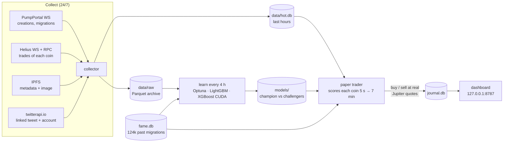

<div align="center">

# PumpML

**A self-learning AI that reads the *narrative* of every new pump.fun memecoin and paper-trades the ones it believes in, 24/7, at real Jupiter prices.**

[](LICENSE)


-green)

[🇫🇷 Version française](README.fr.md) · [Results](#results-so-far-honest-numbers) · [How it works](#how-the-model-decides) · [Quick start](#quick-start) · [Project tree](#project-tree) · [Contribute](#how-you-can-help)


</div>

> [!WARNING]
> **This is a research project, not a money printer.** PumpML has **never** sent a real transaction: every trade is simulated with real Jupiter quotes. After 5 days of data the model ranks coins much better than chance, but it is **not profitable yet**. Nothing here is financial advice. The vast majority of pump.fun coins go to zero.

---

## Why this project

About 25 000 new memecoins launch on [pump.fun](https://pump.fun) (Solana) every day. Almost all of them die within minutes. The few that take off usually have one thing in common: a **story** that people want to share — a viral tweet from a minute ago, a news event, an animal, a joke the whole crypto-Twitter gets.

Trading bots usually look at price, volume and holders. PumpML deliberately does the opposite: **it decides on the narrative only** (tweet, image, name, description, website, creator, similarity to past winners and flops, copies) and keeps price and trade flow *out* of its weights. The question it tries to answer is:

> *Can a machine learn, from tens of thousands of examples, which memecoin stories catch on — before the market does?*

It runs on a single gaming PC (RTX 3070, 32 GB RAM), collects everything itself, retrains itself, and shows what it thinks in a local dashboard.

## What it does



1. **Collect** every coin created on pump.fun (100 % of creations via the mint authority account), its metadata, image, linked tweet and the full trade history of half of them (Helius, coin by coin).
2. **Score** each coin at 12 checkpoints (5 s, 10 s … 7 min after launch) with only the information available at that moment.
3. **Paper-buy** at the first checkpoint where the score passes the threshold, priced with a **real Jupiter quote**, then exit at +50 % / −40 % / after 2 min if nothing happens / after 30 min.
4. **Learn**: every 4 hours, rebuild features and retrain on everything whose outcome is known; a new model replaces the champion **only** if it makes more SOL on hours it has never seen.
5. **Reflect**: every 4 hours, an analysis task reads the biggest real winners, the model's worst buys and the breakouts it missed, and writes the lessons back as annotated examples.

## Results so far (honest numbers)

Data collected from 25/10 to 29/10 (5 days, with one night lost when the PC was off):

| | |
|---|---|
| Coins seen | **150 805** (2.48 M trades, 151 k metadata, 87 k tweets read) |
| Coins scored live by the model | **22 753** |
| Paper buys (0.1 SOL each, Jupiter prices) | **1 110**, of which 780 closed |
| Long-term memory | **124 441** past migrations (90 days on-chain + the [MemeTrans / MELT](https://github.com/git-disl/MELT) academic dataset, CC BY-NC 4.0, not redistributed here) |
| Models trained | **64**, including 5 deep searches of 344–400 trials (CPU + GPU) |

### The ranking works…

On hours the model has never seen, coins it scores in the top 10 % win **5.5 %** of the time, versus **under 0.1 %** for the bottom 40 %. AUC is ~0.77–0.80.


More data helps: training on 1, 2 then 3 days of data on the same unseen test raises AUC from 0.745 to 0.769, and the top-10 % win rate from 4.8 % to 6.4 %.


### …but it does not make money yet

On the same 6 unseen hours, *buying everything* loses about **−14 SOL**; the model only buys a handful of coins and loses **−0.01 to −0.2 SOL**. That is a huge improvement over buying blindly — and still a loss. Live, the paper account is at **−11.4 SOL after 780 trades** (11 % winners). Most of that was lost on day one, before the exclusion rules and the switch to narrative-only signals; since then the curve is almost flat.


The honest verdict: **no proven edge yet.** About two weeks of data are needed before a real conclusion (the next checkpoint is planned around 08/11).

### Things we learned along the way

**Most "pumps" are fake.** Of 732 coins that reached ~$30 000 market cap, only 54 got there organically — the rest were bought in the very first block by their creator's own wallets (bundles). Training on them teaches the model rug-pull narratives.


**Copies lose more than originals.** 708 of the first 1 077 paper buys were copies of an earlier coin (same image, same X link, or same name + ticker). Replaying a "never buy a copy unless its tweet brings new information" rule on those buys would have avoided 390 of them and **6.1 SOL** of losses. The rule is now live (`block_copies`).


<details>
<summary><b>Full experiment log</b> (every change is A/B-tested on unseen hours and written to <code>rapports/experiences/JOURNAL.md</code>)</summary>

| Date | Question | Result (validation = most recent unseen hours) | Decision |
|---|---|---|---|
| 26/10 | Exit at +100 % or +50 %, sell after 2 min if flat? | −9 % losses, positions last 3–5 min instead of 20–26 | Adopted |
| 26/10 | Objective: binary / PnL-weighted / regression | None beats "buy all" per buy | PnL-weighted kept |
| 26/10 | Exclude bundled launches (> 25 % of the curve bought in block 0) | 42 % of AI buys were bundles, losing twice as much live | Adopted |
| 26/10 | Deep search, 400 trials on 1 fold | +0.55 SOL on early-stopping set → −0.13 on validation | Overfitting → 3 folds |
| 26/10 | Narrative only vs all signals (price, flow, time) | narrative −0.13 SOL / 11 buys; all −0.36 / 23 (buy all −11.5 / 1 321) | **Narrative only** |
| 27/10 | "Winner" = peak ≥ $100k **and** still ≥ 30 % one hour later | 101 real winners out of 494 daily-peak "winners" | Hold rule kept |
| 27/10 | KOL (influencer wallet) signals | Same result: a KOL had bought before decision in only 1.1 % of rows | Kept, low impact |
| 27/10 | 10 exit strategies on KOL coins | All negative | Unchanged |
| 27/10 | Predict which coins top KOLs will buy | Upper bound: buying right before a big name = 70 % winners; narrative-only predictor AUC 0.55–0.65 | Too few positives |
| 27/10 | Learning curve 1 / 2 / 3 days | AUC 0.745 → 0.754 → 0.769 | Keep collecting |
| 28/10 | Block copies unless new tweet | 390 / 1 077 buys blocked, −6.1 SOL avoided | Adopted |
| 28/10 | Memory of coins that broke out (~$30k) | −0.049 / 4 buys vs −0.063 / 7, AUC 0.779 vs 0.784 | Inconclusive, retest |

</details>

## How the model decides

**Signals (the only things allowed in the weights)** — `training.feature_groups` in [`config.toml`](config.toml):

| Group | What it looks at | Code |
|---|---|---|
| `narrative` | CLIP embeddings (text + image) on GPU, image ↔ name match, themes (news, politics, animals, AI…) and "gravity" of the coin text and tweet, similarity to coins of the last hours and how they did | [`narrative.py`](pumpml/narrative.py) |
| `tweet` | Linked tweet: age (read free from the tweet ID), author's followers, verification, account age, engagement, reply/quote to a viral tweet, does the tweet name the coin | [`social.py`](pumpml/social.py), [`features.py`](pumpml/features.py) |
| `meta` | Name, ticker, description, website (real site? does its URL match the name?) | [`features.py`](pumpml/features.py) |
| `gagnants` | Long memory of 124 k past migrations: closest real winner and closest flop, copy or *twist* of a famous coin, creator who already made a winner | [`fame.py`](pumpml/fame.py) |
| `copies` | Same ticker / name / image (perceptual hash) / X link as an earlier coin, how the original did | [`vamp.py`](pumpml/vamp.py) |
| `createur` | Creator wallet history: previous coins, migrations, launches in the last hour | [`dataset.py`](pumpml/dataset.py) |
| *(tested)* `kol`, `kolnarr`, `percees` | Influencer wallets that bought, resemblance to what top Kolscan traders buy, resemblance to coins that broke out | [`kol.py`](pumpml/kol.py), [`kolnarr.py`](pumpml/kolnarr.py), [`percees.py`](pumpml/percees.py) |

**Hard rules (never in the weights, always applied):** no bundled launch, no tweet older than 2 min at launch, no "parasite" reply (small account hooking onto someone else's viral tweet), no coin without Twitter or website, no coin flooded by volume bots, no copy of an earlier coin unless its tweet is new and different.

**No look-ahead.** Every feature only uses what was known at `decision time + 3 s latency`: other coins' outcomes only once resolved, memories only once the success was known, annotations only from the time they were written. Each historical feature has a dedicated test in [`tests/test_core.py`](tests/test_core.py).

**Training.** [`search.py`](pumpml/search.py) runs an Optuna search over model family (LightGBM on CPU, XGBoost on CUDA), hyper-parameters, objective, recency weighting and the **weight of each signal group**; the final model is an ensemble of the 5 best trials. Split is temporal and per coin: fit < early-stopping (3 folds) < validation (last 6 h, never used to choose anything). The buy threshold is picked on training data. **Promotion** requires ≥ 10 validation buys, positive PnL and beating the current champion on the same hours.

**Simulation.** Each training row is "what if I had bought 0.1 SOL at this checkpoint": entry after 3 s latency, pump.fun fees (1.25 % each way), 0.0005 SOL per transaction, the exact exit rules. Live paper trades use real Jupiter quotes, never curve math.

## Project tree

```
pumpml/                  the whole system (Python package, run with: python -m pumpml <command>)
├── collector.py         ingestion: PumpPortal + Helius, metadata, X, migrations → data/raw + data/hot.db
├── tokstream.py         per-coin Helius websocket subscriptions with RPC gap-filling
├── amm.py               after migration: PumpSwap pool tracking (observation only)
├── metadata.py          IPFS metadata and image download (several gateways)
├── social.py            X / Twitter providers (twitterapi.io, official API), tweet-ID timestamps
├── pump.py              pump.fun bonding-curve math and transaction decoding
├── storage.py           Parquet schemas, hot SQLite store, retention
├── features.py          per-checkpoint features, exclusion rules, copy veto
├── dataset.py           builds the training table (one row per coin × checkpoint, simulated outcome)
├── narrative.py         CLIP embeddings (text + image), themes, narrative trend
├── vamp.py              copy detection (ticker, name, image hash, X link)
├── fame.py              long memory of past winners and flops (data/fame.db)
├── protos.py            your annotated examples → similarity features and categories
├── kol.py / kolnarr.py  influencer wallets: who bought, and what top traders like
├── percees.py           memory of coins that broke out during our own collection
├── model.py             training, champion / challenger registry, explanations (SHAP)
├── search.py            Optuna hyper-parameter + signal-weight search, ensembles
├── paper.py             live decisions and paper positions at Jupiter prices
├── jupiter.py           Jupiter quote client with rate budget
├── perf.py              per-model performance over 1 h / 4 h / 24 h / 48 h windows
├── dashboard.py         local web dashboard (aiohttp) + API
├── supervisor.py        starts and restarts every service, schedules learning
└── check.py, config.py, logutil.py, feedback.py, backfill.py
web/                     dashboard front-end (vanilla JS, TradingView lightweight-charts)
scripts/                 one-off and scheduled jobs
├── import_fame.py       90 days of migrations on-chain + 15-min candles (GeckoTerminal)
├── import_melt.py       MemeTrans academic dataset → long memory
├── winners_report.py    every 4 h: real winners of the period, to be researched and annotated
├── errors_report.py     every 4 h: the model's worst buys and missed breakouts
├── annotate_winner.py   writes an annotated lesson back into the model's example library
├── kol_activity.py, kol_backfill.py   influencer wallet filtering and on-chain history import
├── make_charts.py       regenerates the charts of this README from your own data
└── pause.ps1, resume.ps1, install_autostart.ps1   Windows service helpers
tests/                   no-look-ahead tests for every historical feature + an end-to-end pipeline test
rapports/                analysis reports and the experiment journal (rapports/experiences/JOURNAL.md)
.claude/skills/          the playbooks the AI assistant follows (experiments, health checks, winner analysis)
config.toml              every setting, commented (strategy, budgets, signals, memories)
data/, models/, logs/    created at runtime — NOT in the repository (you build your own)
```

> The code, comments and reports are written in French (the author is French). Variable names are mostly self-explanatory; feel free to open an issue if something is unclear.

## Quick start

**Requirements:** Windows or Linux, Python 3.11+, ~1 GB disk per day of data. An NVIDIA GPU is strongly recommended (CLIP embeddings, XGBoost); it works on CPU, slower.

```bash
git clone https://github.com/macsborb/pumpml.git
cd pumpml
python -m venv .venv
.venv/Scripts/pip install -r requirements.txt          # Linux: .venv/bin/pip
.venv/Scripts/pip install torch --index-url https://download.pytorch.org/whl/cu130   # pick your CUDA version
.venv/Scripts/pip install sentence-transformers
cp .env.example .env                                   # then fill in your own keys
.venv/Scripts/python -m pumpml check                   # checks keys and data feeds
.venv/Scripts/python -m pumpml supervise               # starts everything
```

Open **http://127.0.0.1:8787**. The first model trains as soon as enough coins have a known outcome (a couple of hours); it needs days to become meaningful.

**API keys** (in `.env`, never committed):

| Service | Needed for | Cost |
|---|---|---|
| [Helius](https://helius.dev) | on-chain trades of each coin | Developer plan ($49/month, 10 M credits) for 50 % of coins; the free plan can follow ~15 % (`sample_fraction`) |
| [twitterapi.io](https://twitterapi.io) | content of the linked tweet and account | ≈ $0.15 per 1 000 tweets (optional — without it, tweet features stay empty) |
| [Jupiter](https://portal.jup.ag) | paper-trading quotes | free (60 quotes/min with a free key, 30 without) |
| PumpPortal | creation / migration events | free |

**Useful commands:** `python -m pumpml status`, `python -m pumpml learn` (train now), `python -m pumpml deepsearch` (long search), `python -m pumpml features --force`, `pytest -q tests`. On Windows, `scripts/install_autostart.ps1` installs it as a scheduled task with automatic restart, and `PumpML-Pause.bat` / `PumpML-Reprendre.bat` pause and resume it (e.g. to play games).

Your data stays on your machine: models are **not** shipped with the repo — you train your own from your own collection.

## How you can help

PumpML is open so that others can try to beat it. Some open questions straight from the experiment journal:

- **Inverted signals.** Similarity to *bad* examples and to past flops currently *raises* the score (the bad examples were often artificial pumps whose price did go up). Remove them from the weights, or turn them into exclusion rules?
- **Empty "crypto project" coins** (name repeated as description, buzzwords, X account that does not exist) make up most losing buys. A cheap "does the linked X account exist?" check?
- **Homoglyph copies**: `Мerge` with a Cyrillic М bypasses the copy detection. Normalise Unicode confusables first.
- **Target**: predict a big take-off (×2 before stop-loss) rather than the PnL of one fixed exit?
- **KOL front-running**: buying right before a top trader is a 70 % winner — can narrative alone predict what they will buy?
- More data: run it on your own machine and share what you find (experiment results, not keys!).

See [CONTRIBUTING.md](CONTRIBUTING.md). Issues and pull requests are welcome — please always report results on **unseen hours**, compared to "buy everything".

## Built with an AI pair-programmer

This project was designed and built in a few days by one person working with [Claude Code](https://claude.com/claude-code) as a pair-programmer: architecture, data collection, model search, dashboard, and the experiment protocol. The playbooks the assistant follows are in [`.claude/skills/`](.claude/skills) and the project rules in [`CLAUDE.md`](CLAUDE.md) — a working example of how to run a long-lived ML project with an AI agent.

## License

[MIT](LICENSE) © 2026 Blanc Robbie ([@macsborb](https://github.com/macsborb)). Use it, fork it, improve it — at your own risk. No warranty, and definitely no financial advice.
